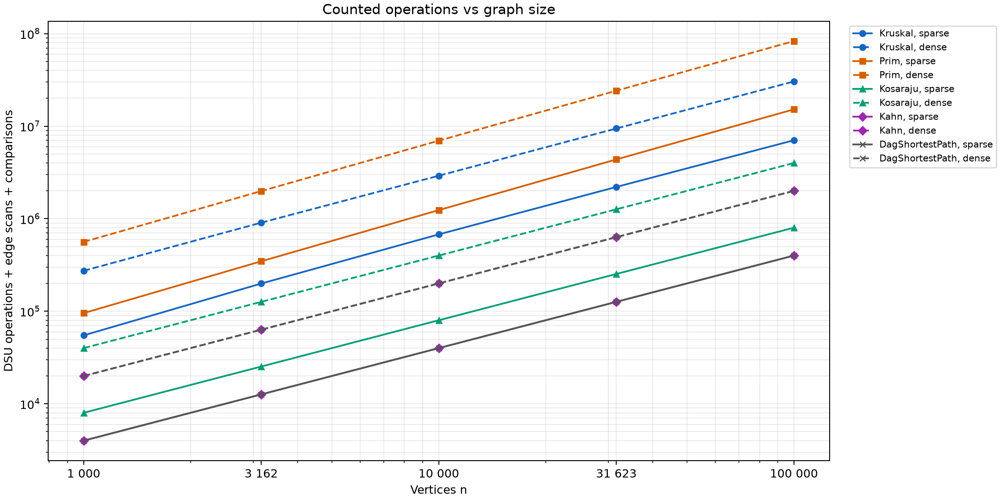
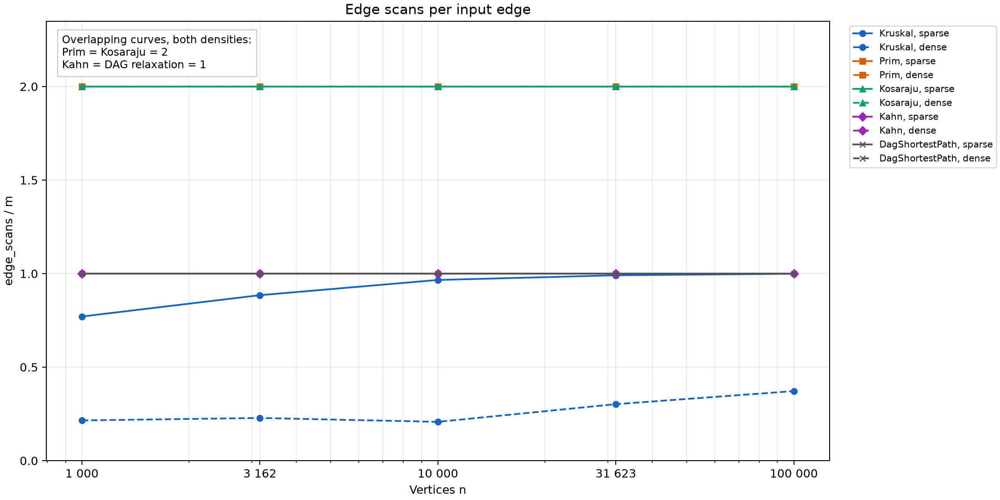
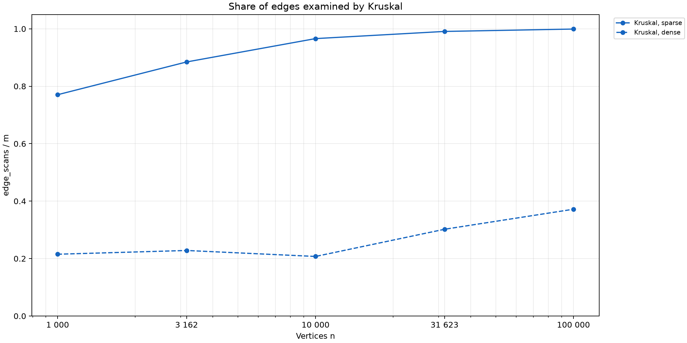

# Graph Algorithms and Operation Counts

Student: Aday Aida
Group: SE-2518

## 1. Implementation and Experimental Setup

The project implements a shared adjacency-list graph representation,
Disjoint Set Union, Kruskal, Prim, Kosaraju, Kahn and shortest paths
in a directed acyclic graph. The graph supports directed and
undirected edges, self-loops, parallel edges, isolated vertices
and disconnected components.

DSU uses union by size and path compression. Both Kosaraju passes
use explicit stacks instead of recursion. Kruskal and Prim return
a minimum spanning forest when the input is disconnected.

The benchmark uses five vertex counts: 1000, 3162, 10000, 31623
and 100000. Each size has two edge counts: m = 4n and m = 20n.
For each configuration, separate undirected, directed and DAG
inputs are generated using a fresh Random(42).

The undirected generator first creates a random spanning tree.
Random non-loop edges keep the first endpoint and resample only
the second endpoint when the endpoints coincide. DAG edges follow
a shuffled vertex ranking, so every edge increases rank.

Five graph algorithms are measured on ten configurations, producing
50 CSV rows. Each time is the median of five runs. Counters are
reset for each run and checked for agreement between repeated runs.
Graph generation is excluded from measured time.

The terms sparse and dense refer to the assignment's m = 4n and
m = 20n families. Both families are asymptotically sparse because
their edge counts grow linearly with n.

## 2. Complexity

Let n denote vertices and m denote input edges. Auxiliary space
excludes the input graph but includes returned results.

| Algorithm or operation | Time | Extra space | Justification |
| --- | --- | --- | --- |
| DSU initialization | O(n) | O(n) | Initialize parent and size arrays. |
| DSU find and union | O(alpha(n)) amortized | O(1) per call, O(n) stored structure | Union by size limits tree depth and path compression shortens later searches. |
| Kruskal | O(n + m log(m + 1) + m alpha(n)) | O(n + m) | Sort copied edges and use DSU while scanning them. |
| Prim with a lazy edge heap | O(n + m log(m + 1)) | O(n + m) | Scan adjacency entries and insert or remove candidate edges from a heap. |
| Kosaraju | O(n + m) | O(n + m) | Two DFS passes, graph reversal, arrays and explicit stacks. |
| Kahn | O(n + m) | O(n) | Copy stored indegrees, queue vertices and scan outgoing edges. |
| DAG shortest paths | O(n + m) | O(n) | Validate the supplied order and relax all edges once. |

Alpha is the inverse Ackermann function. The DSU bound is amortized
over a sequence of operations; an individual operation is not
guaranteed to take constant time.

Prim uses a lazy heap of edges, which may hold O(m) candidates.
Therefore log m is appropriate, especially when parallel edges
are allowed. This implementation does not use a decrease-key heap.

## 3. Correctness

### Cut Property for Kruskal and Prim

Consider a cut that no already selected forest edge crosses.
Let e be a lightest edge crossing this cut.
If an optimal spanning tree extending the selected forest already
contains e, adding it is safe.
Otherwise, adding e to that tree creates a cycle containing another
crossing edge f.
Replacing f with e preserves connectivity and cannot increase
weight, so an optimal tree containing e also exists.
Kruskal applies this property to a cut around a DSU component when
it accepts an edge connecting different components.
Prim applies it to the cut between visited and unvisited vertices
when it selects the lightest frontier edge.
Applying the argument separately to each connected component proves
that both algorithms return a minimum spanning forest.

### Induction for DAG Shortest Paths

Every edge in a topological order goes from an earlier vertex to
a later vertex.
Initializing all zero-indegree vertices to zero is equivalent to
adding a virtual super-source with zero-weight edges.
Assume that all vertices preceding v have their optimal distances
when processed.
Every path ending at v arrives through an earlier predecessor, whose
outgoing edge has already been relaxed.
Taking the minimum over those candidates therefore establishes
the optimal distance to v before processing its outgoing edges.
This proves by induction that one relaxation pass computes all
shortest distances.
Every vertex in a finite DAG is reachable from some source, so
all distances become finite.
Negative weights are safe because cycles are absent; in a general
graph, Dijkstra may fail with negative edges, while a reachable
negative cycle can make shortest distances unbounded.

### SCC and Topological Ordering

Kosaraju records DFS finishing order, reverses the edges and starts
the second pass in decreasing finishing order. Each new traversal
in the second pass identifies one strongly connected component.
Explicit stacks preserve traversal state without growing the JVM
call stack.

Kahn processes vertices whose remaining indegree is zero. If fewer
than n vertices are processed, the remaining subgraph contains a
directed cycle. The implementation reports a cycle and returns no
purported complete topological order.

## 4. Validation

The tests compare DSU with a simple partition model after random
unions. Kruskal and Prim are compared on 100 random connected
graphs, checking equal weights, n - 1 selected edges, absence of
cycles and spanning of the input components.

Kosaraju is compared with independent BFS reachability in both
directions on random graphs with at most 200 vertices. A path of
100000 vertices checks stack safety and reaches explicit stack
depth 100000.

Kahn tests validate random DAG orders and detect cycles, including
self-loops. DAG distances are compared with Bellman-Ford on 100
random DAGs containing negative weights. Restored paths are checked
against their reported distances.

File-based tests use connected, disconnected, cyclic and DAG
examples from data/. Additional cases cover parallel edges,
isolated vertices, empty graphs and invalid inputs.

The benchmark reproduced all supplied reference values:

| n | m | MST weight | SCC count | Sum of DAG distances |
| --- | --- | --- | --- | --- |
| 1000 | 4000 | 147970 | 27 | 396274 |
| 1000 | 20000 | 30363 | 1 | 252411 |
| 3162 | 12648 | 468911 | 137 | 1271911 |
| 3162 | 63240 | 97589 | 1 | 723157 |
| 10000 | 40000 | 1486139 | 373 | 3941828 |
| 10000 | 200000 | 309550 | 1 | 2381342 |
| 31623 | 126492 | 4715515 | 1188 | 12551891 |
| 31623 | 632460 | 968517 | 1 | 7376612 |
| 100000 | 400000 | 15012094 | 3923 | 40096539 |
| 100000 | 2000000 | 3056681 | 1 | 23512087 |

## 5. Counters Compared with Formulas

Counters are incremented inside the algorithms. DSU operations
count find calls plus successful unions, including finds performed
inside union. Comparisons count weight comparator invocations.

Prim scans both adjacency entries of every undirected edge,
giving 2m scans. Kosaraju performs 2m DFS scans across its two
passes; reversal also requires linear work outside this counter.
Kahn uses indegrees maintained during graph construction and scans
m edges on a DAG. DAG shortest paths counts m relaxation scans;
its topological-order validation is additional linear work.

| Algorithm | Density | Normalization | Minimum | Maximum |
| --- | --- | --- | --- | --- |
| Kruskal | sparse | comparisons / (m log2 m) | 0.7447 | 0.9069 |
| Kruskal | dense | comparisons / (m log2 m) | 0.6662 | 0.9027 |
| Prim | sparse | edge_scans / (n + m) | 1.6000 | 1.6000 |
| Prim | dense | edge_scans / (n + m) | 1.9048 | 1.9048 |
| Kosaraju | sparse | edge_scans / (n + m) | 1.6000 | 1.6000 |
| Kosaraju | dense | edge_scans / (n + m) | 1.9048 | 1.9048 |
| Kahn | sparse | edge_scans / (n + m) | 0.8000 | 0.8000 |
| Kahn | dense | edge_scans / (n + m) | 0.9524 | 0.9524 |
| DagShortestPath | sparse | edge_scans / (n + m) | 0.8000 | 0.8000 |
| DagShortestPath | dense | edge_scans / (n + m) | 0.9524 | 0.9524 |

Traversal ratios remain exactly constant at each fixed density.
The Kruskal comparison ratio varies within a limited range and is
consistent with the sorting upper bound. These measurements support
the theoretical analysis but do not prove asymptotic complexity.

Prim's scan ratio describes its linear adjacency traversal only.
Its heap comparisons contribute additional work and must be
included when considering the complete algorithm.

Kruskal's dsu_ops / m ranges from 2.2902 to 2.7483 for sparse inputs
and from 0.5647 to 0.8936 for dense inputs. Early stopping changes
the fraction of edges examined. Find-call counts measure invocation
frequency, not parent-pointer traversals, so they cannot independently
verify the inverse-Ackermann bound.

Combined operations are defined as dsu_ops + edge_scans + comparisons.
This is a reproducible work proxy rather than a count of CPU
instructions. Maximum stack depth is a separate space metric.

## 6. Slopes and Edge Scan Shares

For each density, ordinary least squares fits log(counter) against
log(n). Since m is proportional to n, linear scan growth has slope 1.

| Algorithm | Density | Edge scan slope | Combined operation slope |
| --- | --- | --- | --- |
| Kruskal | sparse | 1.0550 | 1.0520 |
| Kruskal | dense | 1.1194 | 1.0218 |
| Prim | sparse | 1.0000 | 1.1007 |
| Prim | dense | 1.0000 | 1.0850 |
| Kosaraju | sparse | 1.0000 | 1.0000 |
| Kosaraju | dense | 1.0000 | 1.0000 |
| Kahn | sparse | 1.0000 | 1.0000 |
| Kahn | dense | 1.0000 | 1.0000 |
| DagShortestPath | sparse | 1.0000 | 1.0000 |
| DagShortestPath | dense | 1.0000 | 1.0000 |

Kruskal's edge scan slope depends on early stopping and does not
measure the sorting logarithm. Sorting comparisons provide the
relevant evidence for that work. The finite fitted slopes should
not be interpreted as exact asymptotic exponents.

Prim and Kosaraju coincide at two scans per input edge. Kahn and
DAG relaxation coincide at one. Overlapping curves are expected.

On sparse inputs, Kruskal examines about 77.1% to 99.9% of the
sorted edges. On dense inputs, the observed share is about 20.7%
to 37.2%. The dense family supplies more redundant edges, allowing
the tree to finish after a smaller fraction of the list.
However, Kruskal still sorts all m edges.

## 7. Choosing an Algorithm

| Situation | Choice | Reason |
| --- | --- | --- |
| Sparse undirected graph provided as an edge list | Kruskal | Sorting and DSU directly use the representation. |
| Undirected graph stored as adjacency lists | Prim | Grow a tree through the frontier heap; restart for disconnected components. |
| Truly dense simple graph with about n squared edges | Consider matrix Prim | O(n squared) avoids heap overhead; this project implements the required heap variant. |
| Directed graph with possible deadlocks | Kosaraju | Find mutually reachable groups of jobs. |
| Need a dependency order or cycle report | Kahn | Process ready jobs and detect failure to consume all vertices. |
| DAG with positive or negative weights | DAG shortest paths | One topological relaxation pass is sufficient. |
| General graph with nonnegative weights | Dijkstra | Appropriate when no DAG structure is available. |
| General graph with negative weights | Bellman-Ford | Handles negative edges and detects reachable negative cycles. |

Neither MST algorithm is universally preferable. Kruskal sorts
every edge, while lazy Prim performs heap operations and removes
stale candidates. Edge representation, redundancy and graph
structure affect their practical costs.

## 8. Running Times

For the largest sparse graph, median times were about 35.21 ms
for Kruskal and 77.52 ms for Prim. For the largest dense graph,
they were 190.76 ms and 844.31 ms respectively. Kosaraju took
194.19 ms on the largest dense directed graph, while Kahn took
55.67 ms and DAG shortest paths took 31.41 ms on the corresponding
DAG. These measurements describe this implementation and run.
There was no separate JVM warmup phase, so JIT compilation, garbage
collection and allocation affect the results. Different hardware,
JVM versions and background load can change times substantially.
Operation counters are therefore the primary evidence for growth.